<a href="https://arturoalvarez.dev">
  
</a>

<br />


> **Ingeniero Civil en Computación** orientado a Cloud Computing, DevOps y Site Reliability Engineering.
> Construyo infraestructura **observable, automatizada y resiliente**.

Trabajo en la intersección entre infraestructura cloud, redes y automatización: desde servidores Linux y pipelines CI/CD hasta Kubernetes, SDN y observabilidad.

```yaml
whoami:
  role:     Cloud & DevOps Engineer
  location: Curicó, Chile · UTC-4
  focus:    [cloud, devops, sre, sdn]
  status:   available_for_opportunities
```



<p align="center">
  <a href="https://github.com/ArturoAlvarezz/ryu-k3s"></a>
  <a href="https://arturoalvarez.dev/projects/arm64-home-infrastructure"></a>
  <a href="https://fuegodance.cl/"></a>
  <a href="https://sherlock.arturoalvarez.dev/"></a>
</p>





<a href="https://arturoalvarez.dev">
  
</a>

<p align="center">
  <a href="https://arturoalvarez.dev"><b>PORTFOLIO</b></a> &nbsp;·&nbsp;
  <a href="https://www.linkedin.com/in/arturo-alvarez-48804519b/"><b>LINKEDIN</b></a> &nbsp;·&nbsp;
  <a href="https://arturoalvarez.dev/cv.pdf"><b>CV</b></a> &nbsp;·&nbsp;
  <a href="https://www.credly.com/badges/fd7c4f63-5704-4c47-939a-1ad699cf7ddb/public_url"><b>AWS CERT</b></a>
</p>

<!-- Los SVG se generan con scripts/build.py (texto convertido a trazos con fontTools). -->
